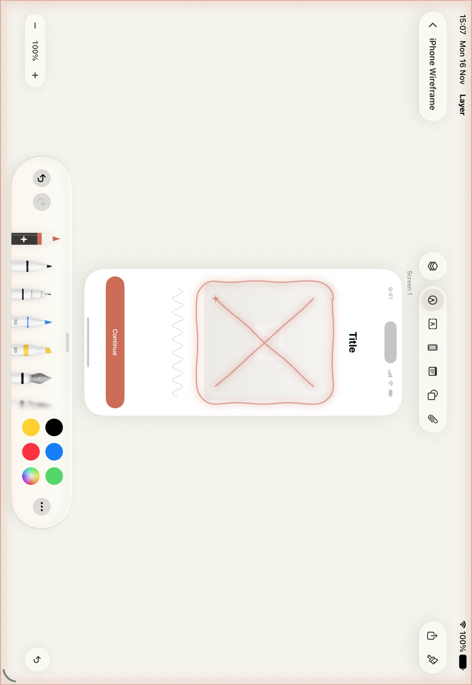
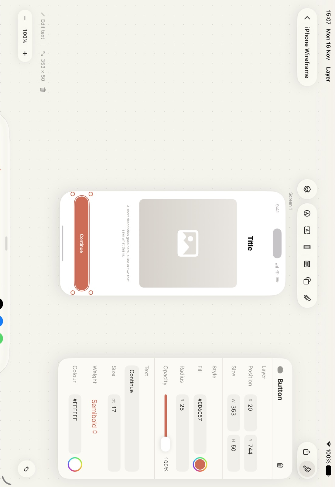
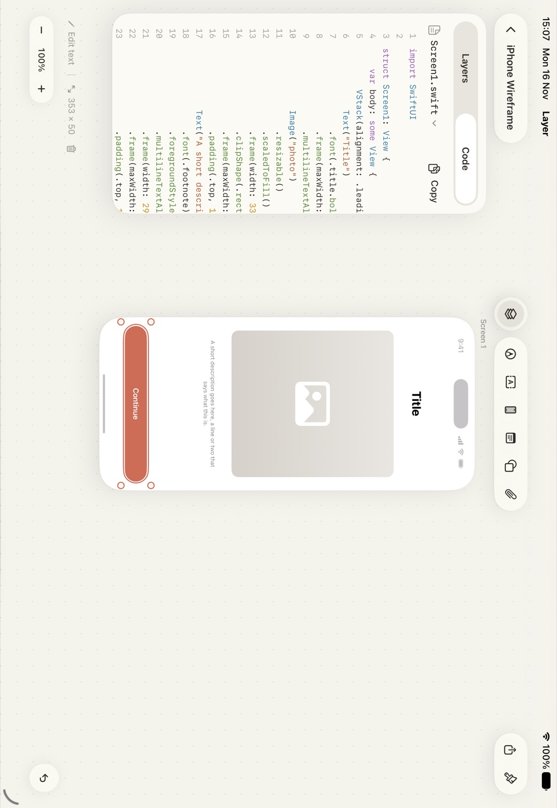

# Layer

Sketch a phone screen with Apple Pencil and Layer turns it into a real design, then into SwiftUI code.

Layer is a freeform canvas for iPad. Draw a tall rectangle and it becomes an iPhone frame. A zigzag at the top becomes a title. A box with a cross becomes an image, stacked lines become body text, and a rounded bar becomes a button. Everything stays editable, and every screen has its SwiftUI source a tap away.



## Features

- **Magic Pen.** A pen in the PencilKit palette whose strokes are read as interface elements. The full palette (pens, eraser, lasso, ruler) is there too and draws ordinary ink.
- **Apple Intelligence first.** Built-in shape rules settle clear sketches instantly. On the close calls, such as a rounded box that could be a button or a text field, the on-device model decides from what else is on the screen. Without Apple Intelligence the rules decide everything, so Layer works on any iPad.
- **A real canvas.** Pinch to zoom, pan, lock the canvas, zoom to fit. Frames, elements and drawings can be selected, moved and resized, with snapping and spacing guides.
- **Add things directly.** Text, device frames (iPhone, iPhone Pro Max, iPhone SE, iPad), sticky notes, SF Symbols and images.
- **Freeform-style objects.** A bar above the selection duplicates, locks and reorders it (⌘D, ⌘L, ⌘], ⌘[). Dragged things snap to smart guides or the grid. Layers can be named, hidden and locked.
- **Format panel.** Position, size, fill, border, shadow, corner radius, opacity, alignment and type for the selection, plus arranging and aligning it on its screen.
- **Board menu.** Tap the board's name to rename it. Below the name, tabs hold the canvas settings (background, grid, guides), the Magic Pen settings with a guide to the shapes it reads, the code options and iCloud status.
- **More Magic Pen shapes.** A small pill becomes a toggle and a small circle an avatar. Beside the screens, a box becomes a sticky note and a squiggle becomes text. Scratching back and forth over an element deletes it.
- **SwiftUI code.** The Layers panel's Code tab shows each screen as SwiftUI, ready to copy or share. The code can be a stack or use exact positions, end with a `#Preview`, and use the title as a navigation title. Every screen can be shared as files at once.
- **Documents and iCloud.** Designs are documents in Files and iCloud Drive. A design's file is named after its board, the document browser shows a thumbnail of each board, and versions edited on two devices at once are both kept.
- **Any window size.** In a narrow window the tools fold into a menu, the panels become sheets and the palette can be tucked away.





## Requirements

- iPadOS 26.6 or later
- Xcode 27.2 or later to build
- [XcodeGen](https://github.com/yonaskolb/XcodeGen) (`brew install xcodegen`)
- Apple Intelligence is optional

## Building

The Xcode project is generated from `project.yml`, so regenerate it after adding or removing files:

```sh
xcodegen generate
open Layer.xcodeproj
```

Run the tests in a simulator:

```sh
xcodebuild -project Layer.xcodeproj -scheme Layer \
  -destination "platform=iOS Simulator,name=<an iPad simulator>" test
```

The UI tests expect a landscape iPad simulator with the app's window full screen.

## Project layout

| Folder | What's in it |
| --- | --- |
| `Layer/App` | The app, its document scene and the per-design model |
| `Layer/Canvas` | The canvas: PencilKit ink, screens, selection, effects |
| `Layer/Chrome` | Top bar, panels, zoom and undo controls, share menu |
| `Layer/Sketch` | Reading sketches: shape analysis, rules, Apple Intelligence |
| `Layer/Model` | Screens, elements, layout and the design store with undo |
| `Layer/Document` | The `.layer` package format, file naming and iCloud |
| `Layer/Code` | The SwiftUI code generator and its syntax colouring |
| `LayerThumbnails` | Quick Look extension that draws thumbnails for Files |
| `LayerTests`, `LayerUITests` | Unit tests and end-to-end UI tests |

## Adding another model provider

Apple Intelligence is the built-in provider. To add a hosted model, write a type that conforms to `SketchInterpreter` in `Layer/Sketch/SketchInterpreter.swift` and add it to `SketchProvider.all`. Providers that need an API key set `needsAPIKey`, and the key is passed to `makeInterpreter`.
